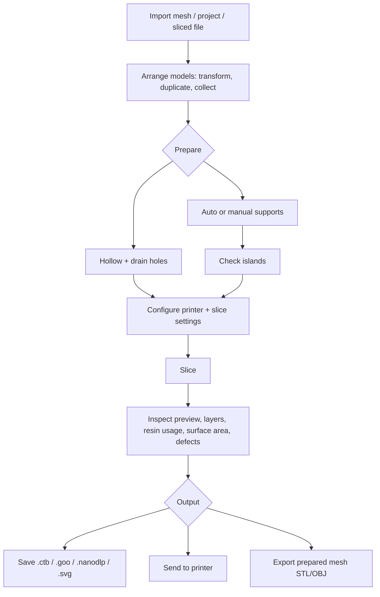

# mslicer — UI & Feature Overview

**Version documented:** 0.10.0 (build from `main`, November 2026)

> **Build note:** the binary used for these screenshots reports **v0.10.0** in the About dialog. The working tree also contains in-development features that are not in the v0.10.0 release (notably the Hollowing tab, the Islands check, mini supports and the reworked viewport camera), so this document describes the current tree rather than only the released build.

**Purpose of this document:** a complete functional inventory of mslicer's UI, windows, panels and tools, intended for a design model that will restructure the application. It describes *what exists today*, where it lives, how it behaves, and which parts depend on each other. Every screenshot in `./screenshots/` is referenced below.

> **How to use this for a redesign**
> Treat this as the source of truth for feature parity. The current information architecture is one possible arrangement, not a requirement. Keep the capabilities, states, warnings and data shown here; regroup them freely. Section 12 contains design-relevant observations, Section 11 maps features to their current location, and Section 13 is a checklist you can use to verify that nothing was dropped.

## Contents

- [1. Product summary](#1-product-summary)
- [2. Core concepts and user workflow](#2-core-concepts-and-user-workflow)
- [3. Application shell](#3-application-shell)
- [4. Menus](#4-menus)
- [5. Panels in detail](#5-panels-in-detail)
  - [5.1 Models](#51-models)
  - [5.2 Slice Config](#52-slice-config)
  - [5.3 Supports](#53-supports)
  - [5.4 Islands](#54-islands)
  - [5.5 Hollowing](#55-hollowing)
  - [5.6 Notes](#56-notes)
  - [5.7 Workspace](#57-workspace)
  - [5.8 Remote Print](#58-remote-print)
  - [5.9 Logs](#59-logs)
  - [5.10 Sliced](#510-sliced)
  - [5.11 Viewport](#511-viewport)
- [6. Tool windows (popups)](#6-tool-windows-popups)
- [7. Dialogs, popups and transient UI](#7-dialogs-popups-and-transient-ui)
- [8. Keyboard and mouse reference](#8-keyboard-and-mouse-reference)
- [9. Files, formats and persistence](#9-files-formats-and-persistence)
- [10. State, async work and feedback](#10-state-async-work-and-feedback)
- [11. Where features live today](#11-where-features-live-today-feature-to-location-map)
- [12. Design-relevant observations](#12-design-relevant-observations)
- [13. Complete feature checklist](#13-complete-feature-checklist)
- [14. Screenshot index](#14-screenshot-index)

---

## 1. Product summary

mslicer is a high-performance, open-source slicer for **MSLA resin printers**. It imports meshes and projects, arranges and prepares models, generates supports, hollows models, slices them into per-layer raster or vector data, previews and analyses the result, then saves or sends it to a printer.

- **Output formats:** Chitu (encrypted v5 `.ctb`), Chitu Legacy (unencrypted v4 `.ctb`), Elegoo (`.goo`), NanoDLP (`.nanodlp`), and SVG vector slices.
- **Input formats:** `.stl`, `.obj`, mslicer projects (`.mslicer`), sliced files (`.ctb`, `.goo`, `.nanodlp`), images (PNG/JPEG/etc.), Gerber files (`.gbr`), WAV audio (phonograph tool), and STEP files (experimental BREP slicer).
- **Mesh export:** STL and OBJ.
- **Platform:** Windows, Linux and macOS. Linux builds are also distributed via Flathub and Nixpkgs.
- **Technology:** Rust, `egui`/`eframe` for the immediate-mode UI, `wgpu` for rendering, `egui_dock` for the tabbed docking layout.

The application is a **single-window, tabbed workspace**. There is no separate "prepare" vs "print" mode; preparation, slicing, inspection and sending all happen in the same window, with panels that can be shown, hidden, tabbed, split and floated (via the docking system).

---

## 2. Core concepts and user workflow

| Concept | Meaning in the UI |
|---|---|
| **Project** | The working document. Contains models, collections, notes, slice configuration, support configuration and post-processing settings. Saved as a single `.mslicer` file with embedded meshes. |
| **Model** | An imported mesh plus its name, transform (position/scale/rotation), color, relative exposure, units, visibility, supports and hollowing settings. Models can be grouped into **collections**. |
| **Collection** | A named, collapsible group of models, used to organize the model list and to select/hide/delete several models together. |
| **Slice config** | Printer/platform, resolution, layer height, anti-aliasing, bottom/transition layers, normal/first-layer exposure, and post-processors. The project has its own slice config; the global default can be saved from the panel. |
| **Supports** | Per-model support sets (generated and manual) with a support preset, raft settings and routing. Supports are generated on the model and routed to the build plate or onto the model. |
| **Hollowing** | A per-model shell and drain-hole specification. The original mesh is preserved; slicing, export and support generation use a hollowed copy. |
| **Slicing** | Converts the prepared scene into layers. **Raster** mode produces per-layer bitmaps; **Vector** mode produces SVG geometry. A completed slice is shown in the **Sliced** panel. |
| **Global config** | Application preferences stored in `config.toml` (theme, rendering, remote print, printer presets, default slice config, recent projects). |

### End-to-end workflow

---

## 3. Application shell

*The default layout: **Models** on the top-left, **Slice Config / Supports / Islands / Notes** as tabs in the middle-left, **Workspace / Remote Print** at the bottom-left, and the **Viewport** on the right. A teapot model is shown in the viewport.*

### 3.1 Window

- One native window, initially **1920 × 1080**, centred, with drag-and-drop enabled.
- The window has a custom top bar (the operating system's title bar is not used for app content).
- The layout is an **`egui_dock` dock area**: panels are tabs; tabs can be dragged between leaves, split, floated (allowed for every tab except the Viewport), and closed.
- The **Viewport** is a special tab that cannot be closed and cannot be detached into a floating window. If the saved layout ever lacks a Viewport, the app resets to a single Viewport tab.
- The left column has a **minimum width of 325 px**; its width scales with the window and is clamped to that minimum.
- The dock layout is persisted in `config.toml` and restored on launch. **View → Reset Interface** restores the default layout.

### 3.2 The eleven tabs

| Tab (internal name) | Default placement | Can close? | Purpose |
|---|---|---|---|
| **Viewport** (`Viewport`) | Right, full height | No | 3D scene, camera, selection, supports, hollowing holes, islands. |
| **Models** (`Models`) | Left, top | Yes | Model/collection tree plus properties of the selection. |
| **Slice Config** (`SliceConfig`) | Left, middle tab group | Yes | Printer, platform, layer/exposure, anti-aliasing, post-processors. |
| **Supports** (`Supports`) | Left, middle tab group | Yes | Preset and routing settings, generate/clear supports, selected-support editor. |
| **Islands** (`Islands`) | Left, middle tab group | Yes | Island detection, navigation and one-click support placement. |
| **Notes** (`Notes`) | Left, middle tab group | Yes | Project notes saved in the project file. |
| **Workspace** (`Workspace`) | Left, bottom tab group | Yes | Rendering, camera, theme, limits, Spacenav, performance and memory stats. |
| **Remote Print** (`RemotePrint`) | Left, bottom tab group | Yes | Printer discovery/connection, print control, webhook and services. |
| **Sliced** (`Sliced`) | Opened next to the Viewport when a slice completes; hidden otherwise | Yes | Slice result, preview, analysis, save, send, reconstruct, unload. |
| **Hollowing** (`Hollow`) | Hidden by default | Yes | Hollow shell and drain-hole editor. |
| **Logs** (`Logs`) | Hidden by default | Yes | Live application log. |

The **View → Windows** checklist shows ten of these (Hollowing, Islands, Logs, Models, Notes, Remote Print, Slice Config, Sliced, Supports, Workspace). Viewport is always present.

### 3.3 Top bar

The top bar is always visible and contains:

- **mslicer** wordmark.
- **File**, **Edit**, **Tools**, **View**, **Help** menus.
- **Slice** button (with the Ctrl+R shortcut shown), disabled while a slice is running.
- On the far right: the **background-task monitor** (hourglass icon; it becomes a progress ring while tasks are active). Clicking it opens a popup with a grid of task names and progress bars; hovering a row shows details.

The top bar is the only global command surface. It is also where the "global" actions live that are not tied to a panel.

---

## 4. Menus

### 4.1 File

| Group | Item | Shortcut | Behaviour |
|---|---|---|---|
| Import | Load Mesh | Ctrl+I | Multi-select STL/OBJ import. |
| Import | Utah Teapot | Ctrl+T | Loads the built-in teapot STL. |
| Import | Load Sliced | Ctrl+Shift+I | Loads a sliced `.goo`/`.ctb`/`.nanodlp` file directly into the Sliced panel. |
| Project | New | Ctrl+N | Asks to save unsaved work, then resets the project. |
| Project | Open | Ctrl+O | Opens a `.mslicer` project (with unsaved-changes prompt). |
| Project | Recent | — | Submenu of recent project paths. |
| Project | Save | Ctrl+S | Saves the project; if it has no path, opens Save As. |
| Project | Save As | Ctrl+Shift+S | Saves the project to a new `.mslicer` file. |
| Misc | Install | — | Windows-only, shown when running portably: installs the app and relaunches. |
| Misc | Quit | Ctrl+Q | Closes the application. |

### 4.2 Edit

- **History:** Undo (Ctrl+Z), Redo (Ctrl+Y), Clear, and an **Actions** submenu listing undo/redo history entries (with optional detail tooltips). The Actions menu scrolls through history in both directions.
- **Selections:** Select Models (Ctrl+A), Deselect (Ctrl+Shift+D).

Undo/redo is action-based and covers model transforms, supports, hollowing, collections, slice-config changes, and more. Large deleted meshes may be dropped from history according to the **Max History Mesh** limit in Workspace → Limits.

### 4.3 Tools

| Group | Item | Opens |
|---|---|---|
| Auto Layout | Quick Layout (Ctrl+L) | No window; immediately arranges visible models using the **Quick Layout Spacing** setting. |
| Auto Layout | Auto Layout | Modal-style tool window with annealing options. |
| Exposure | Printed Circuit Board | PCB photolithography tool window. |
| Exposure | Image Layer | Single-layer image exposure tool window. |
| Calibration | Test Pattern | Test pattern generator window. |
| Calibration | Exposure Test | Exposure gradient prism window. |
| Calibration | Internal Exposure Test | Internal exposure gradient prism window. |
| Mesh | Height Map | Grayscale height-map → mesh window. |
| Fun | Phonograph Record | Audio → record mesh window. |
| Fun | 3D Graphics | Render the scene into a sequence of slices window. |
| Miscellaneous | Collect Instances | No window; groups models that share the same mesh into collections. |
| Miscellaneous | Sliced Diff | Compare two sliced files. |
| Experimental | SDF Slicer / Brep Slicer | Only present in experimental builds; disabled with a hover message otherwise. |

### 4.4 View

- **Reset Interface** — restores the default dock layout.
- **Windows** — a checkbox per panel (Hollowing, Islands, Logs, Models, Notes, Remote Print, Slice Config, Sliced, Supports, Workspace). Checking adds the tab; unchecking closes it. The Viewport is not listed and cannot be closed.

### 4.5 Help

- Project Homepage, Zulip Chat, Source Code, Bug Report (open the default browser).
- **About mslicer** — opens the welcome/about modal.

### 4.6 Task monitor

The hourglass button at the top-right opens a progress popup whenever background tasks are running. Each row is a task name plus a percentage bar; hovering reveals details (e.g. file path, stage). Task progress is also reflected in the icon as an animated ring.

---

## 5. Panels in detail

### 5.1 Models

**Purpose:** the scene outliner and the single place where a model's identity, transform, appearance, units and mesh operations are edited.

**Empty state:** "No models loaded yet."

**Model list**
- Collections are shown first, each as a header row with a folder icon (open/closed), name, and collapse toggle.
- Ungrouped models follow, then models inside each expanded collection.
- A model row shows:
  - **Visibility** eye / eye-slash button (hide/show).
  - **Name** — edit it with the Rename action or the R shortcut while the model is selected.
  - **Warning badges** if the mesh is defective or out of bounds (with a count and hover explanation).
  - A **line-segment icon** when support acceleration structures exist (hover: "supportable").
- Click selects; **Shift+click** adds to the selection.
- Drag a model row to reorder it or drop it on a collection header to move it into that collection. A white insertion line/outline shows the drop target.
- Clicking empty space clears the selection.

**Selection toolbar** (shown above the list when models are selected)
- Delete (D)
- Collect (G) — creates a new collection containing the selected models.
- Duplicate (C)
- Prepare — only when **Prepare Models for Supports** is disabled; builds the acceleration structures needed for support placement.

**Collection properties** (when a collection header is selected)
- Rename (R), Delete (D), Hide All / Show All (H), Select Models (S).

**Single-model properties**
- **Action row:** Rename (R), Delete (D), Duplicate (C), Collect (G), Align to Bed (A), Replace (file picker), Reload (from the original file), and a **Mesh** submenu:
  - Split Bodies (F)
  - Flip Winding Order
  - Repair (mesh repair tool)
  - Export → STL / OBJ (exports the *hollowed* mesh if hollowing is enabled).
- **Transform** (collapsible, open by default):
  - Position: X/Y/Z drag values. Z is locked while the support tool is active and the model has supports.
  - Scale: X/Y/Z, with a link/unlink button for proportional scaling. Locked in the support tool with supports.
  - Rotation: X/Y/Z in degrees. X/Y locked in the support tool with supports; Z remains editable.
  - Color: RGB color picker and a **Random** button. Random colors avoid the warning hue.
- **Miscellaneous** (collapsible):
  - Mesh Units: Millimeters, Centimeters, Meters, Inches, Feet, or Custom factor.
  - Exposure: relative exposure percentage (0–100%).
  - Faces: count and memory usage.
  - Volume: cm³ (calculated asynchronously).

**Selection properties** (multiple models)
- Delete, Collect, Duplicate and (optionally) Prepare, applied to every selected model.

**Warnings**
- **Defective mesh** — slicing may fail or be incorrect.
- **Out of bounds** — the model extends beyond the build volume.
- Warnings are shown inline in the model list and are used to color/flag models.

**Dependencies / interactions**
- Selection drives Viewport highlighting, Hollowing, Supports, Islands, and the model properties pane.
- Transforms and colors are undoable.
- Support-tool locking prevents changes that would invalidate existing supports.

---

### 5.2 Slice Config

**Purpose:** define the printer, physical build volume, layer geometry, exposure, anti-aliasing and post-processing. This is the "settings" panel that feeds the slice operation.

**Top actions**
- **Reset to Default** — copies the global default slice config into the project.
- **Set Default** — saves the current project slice config as the global default for new projects.

**Printer**
- **Slice Mode:** Raster or Vector.
- **Printer dropdown:**
  - **Custom** — use the project's own platform resolution and size.
  - **Your Presets** — user-created printers (name, resolution, size).
  - **Brand submenus** with built-in presets: Elegoo, Phrozen, Concepts3D, ApexMaker, Creality, Emake3D, EPAX, HIFUN, HITRY, LYNcase, Magforms, NOVA3D, Newbie Box, Peopoly, QIDI, UniFormation, WanHao.
  - Presets hover with build volume, resolution and pixel size. Presets known to work with mslicer carry a check icon.
  - The **pencil** button opens the **Edit Your Printer Presets** window (add, edit, delete custom presets).
- **Custom printer fields:** Platform Resolution (pixels) and Platform Size (mm, X × Y × Z). Choosing a preset fills these.
- Changing the platform updates out-of-bounds warnings on all models.

**Layer geometry**
- **Slice Height** — micrometres.
- **Anti Aliasing** — supersampling factor. The link/unlink button toggles anisotropic AA (separate XY and Z factors). The tooltip explains that the value is the number of effective samples per voxel.
- **Bottom Layers** — shown in millimetres or as a layer count; a toggle switches the representation.
- **Transition Layers** — interpolation between first-layer and normal exposure.

**Exposure configuration**
- **Normal Layers** (collapsible) and **First Layers** (collapsible), each a table with:
  - Exposure time (seconds)
  - PWM / intensity (%)
  - Exposure delay (seconds)
  - Lift distance (mm)
  - Lift speed (mm/min)
  - Retract speed (mm/min)
- These same controls appear in the **Sliced** panel, where they can be edited after slicing and can be overridden per layer.

**Post Processors**
- **Exposure Remapping** — a Bézier curve editor (`start`, two control points, `end`) mapping fractional exposure values to voxel growth. A plot shows the curve and its handles. Dragging a handle updates the mapping; the curve is used during slicing.
- **Variable Layer Height** — merges identical layers into thicker layers.
  - Threshold (maximum average value deviation, value/mm²)
  - Max Layers
  - Exposure (seconds)
  - Note: this post-processor disables NanoDLP saving.
- **Elephant Foot Fixer** — reduces the exposure of the edges of bottom layers.
  - Inset Distance (mm)
  - Intensity (%)
  - Warning tooltip that large inset distances drastically increase post-processing time.

**Notes**
- The Previews, Camera, Models, interface and limits settings live in the **Workspace** panel, not here.
- The slice mode determines which output formats are offered later (raster vs SVG).

---

### 5.3 Supports

**Purpose:** configure support geometry and raft generation, then generate, clear, select, edit and delete supports directly on the model.

**Toolbar**
- **Prepare** — visible only when **Prepare Models for Supports** is off; builds acceleration structures for the selected models.
- **Auto** — generates supports for the selected models (or opens a model picker if none is selected).
- **Clear** — removes supports from the selected/only model.

**Selected-support state**
- "N supports selected across M models."
- Delete, Deselect.
- When one support is focused, its settings are shown; editing a value re-routes *all selected supports* in the background. Picking a whole preset applies it to all selected supports.
- An "N supports found no route with these settings and kept their old ones" notice appears when routing fails; **Select Them** selects exactly those supports.

**Preset**
- **Light**, **Middle**, **Heavy** built-in presets, plus "Custom" when values are edited.
- When supports are selected, the dropdown label becomes "Selected (N)".

**Preset groups** (all collapsible)
- **Top**
  - Cone Top Diameter
  - Contact Depth
  - Cone Length
- **Middle**
  - Pillar Diameter
  - Model Clearance
  - Slim Diameter
  - Slim Contact Depth
- **Bottom**
  - Base Shape: Skate, Cone, Cylinder, None
  - Base Diameter
  - Base Thickness
  - Boss Height
  - Boss Bottom Diameter
  - Tail Depth

**Raft** (collapsible)
- Applies to the target model's raft, or to the preset for new supports when no model is targeted.
- Shape: None, Skate, Cross Grid
- Area Ratio (%)
- Thickness (mm)
- Lip Height (mm)
- Lip Angle (degrees)
- Grid Cell (mm)
- Grid Bar Width (mm)

**General** (collapsible)
- Default Lift (mm)
- Max Angle (degrees)
- Minimum Support Spacing (mm)

**Mesh** (collapsible)
- Resolution

**Manual placement (viewport)**
- Click a model to make it the working model; click again to add a support.
- Click a support to select it; Shift adds to the selection; drag a contact point to move it; drag empty space to box-select.
- Delete removes selected supports; Escape cancels a drag.
- Ctrl+click always places a **mini support** (a short strut onto the model) where a full support will not fit.
- Where the model below is too close for a full support, a mini support is placed automatically.
- The support tool shows a warning that support generation/placement is still in development and recommends RuneBrace for production use.

**Dependencies**
- Supports require acceleration structures; Prepare/Auto builds them on demand.
- Re-routing runs in the background and is undoable.
- Support settings are saved per project (`support_config`) and per model (auto and manual sets + raft).
- Supports are sliced along with the model; they do not alter the source mesh.

---

### 5.4 Islands

**Purpose:** find places where a model starts in mid-air (an island) with nothing under it, show them in the viewport, and add supports or ignore them.

**Idle state**
- Explanation of islands.
- **Accuracy:** Layer, Half, Quarter (check every layer, every second, every fourth). Coarser is faster but can be a few layers off.
- **Minimum Area** (mm²).
- **Start Check** — for the selected model(s), or a menu to choose All Models or a single model.

**Running state**
- Accuracy and minimum area remain editable.
- **Navigator strip:** previous/next island (or N / Shift+N over the viewport), "N unsupported islands", "All islands supported", "No islands found", plus a **Support (+)** button and an **Ignore** (eye-slash) button for the current island.
- **Fix All** — adds a support to every unsupported island.
- **Done** — ends the check.
- Warnings:
  - "No support could be routed to an island on `model`. Try placing one by hand in the support tool."
  - "`model` has holes in its mesh: N layers didn't close, so islands there may be missing."
- **Island list:** every island bottom-up per model, showing `z` height, area, model name (when several models are checked), and a status icon (supported, unsupported, ignored). Clicking an island in the list frames it; the + button supports it.
- While running, the viewport highlights unsupported islands. In the support tool, the island under the pointer lights up.

**Dependencies**
- Requires a selected model or an explicit model choice.
- Adds supports to the model's support set; supports appear in the Supports panel and the viewport.
- Ignores are cleared on the next detection.

---

### 5.5 Hollowing

**Purpose:** hollow a model to save resin and drill drain holes, without modifying the original mesh.

**Header**
- Explanation: only a wall of the set thickness is kept; drain holes let resin out; slicing/export/supports use a copy with the cavity and holes.
- Target model name (selected model, or the only model).
- If no model is usable: "Select a model to hollow it."

**Shell**
- **Hollow** checkbox.
- **Wall Thickness** (0.5–10 mm).
- **Detail:** Fine (0.3 mm), Normal (0.5 mm), Coarse (0.8 mm) cavity sample spacing.
- Status/estimate:
  - "Finding the cavity…"
  - "No room for a cavity: the model is nowhere thicker than two walls."
  - "Saves about N ml of resin" (and "in N voids" when there are several cavities).

**Drain Holes**
- **Diameter** (0.5–10 mm).
- **Depth** (0.2–20 mm) — only shown when the model is not hollowed; in a hollowed model, holes always go through the wall into the cavity.
- **Place Holes** — toggles a mode where clicking the model drills a hole at that point and clicking a hole removes it; Escape stops.
- **Add Drain Holes** — a hole up into the lowest point of each void; enabled once the cavity exists and there are drains to make.
- A warning when any void has no drain hole: "the resin inside stays trapped and can burst the print."
- **Hole list:** "Hole N: Ø diameter, depth/through the wall"; a failed hole shows "didn't work, try another spot" with an explanation; each row can be shown (hover/click) and removed. **Remove All** clears the list.
- "Drilling the holes…" progress state.

**Dependencies**
- Requires a selected model.
- Hollowing affects the mesh used by slicing, mesh export and supports; the original mesh remains intact.
- Holes are undoable and are stored in the project (`HollowSpec`).

---

### 5.6 Notes

**Purpose:** free-form project notes, saved inside the `.mslicer` file.

- **Copy** — copies the entire note to the clipboard.
- **Clear** — empties the note.
- A full-height multiline text editor with the hint "Anything you write here will be saved into the project file for future reference."

---

### 5.7 Workspace

**Purpose:** application-level preferences, rendering/camera controls, interface theming, limits, Spacenav and diagnostic stats. It is the "settings + diagnostics" panel.

**Top actions**
- **Open Config Directory** — opens the folder containing `config.toml` and `latest.log`.
- **Reset Config** — replaces the in-memory config with defaults.

**Rendering**
- **Preview Image** (collapsible)
  - Background color
  - Size (pixels)
  - Projection: Perspective / Orthographic
  - FOV (degrees)
  - Changes update the interactive preview immediately.
- **Camera**
  - Reset, View All (frames all visible models)
  - Projection, FOV
  - View: Target (XYZ), Angle (two values), Distance
- **Models**
  - Render Style: Rendered, Normals, Triangles (debug-oriented)
  - Overhangs: enable/disable, angle (degrees), color
  - Normals: debug renderer toggle + color
  - Bounding Boxes: debug renderer toggle + color
- **Anti Aliasing** (toggle + collapsible)
  - Mode: FXAA (TAA exists in the code but is not exposed in this build)
- **Ambient Occlusion** (toggle + collapsible)
  - Scale, Samples, Range, Bias
  - Blur: Radius, Spatial, Depth, Normal

**Miscellaneous**
- **Interface**
  - Theme: Dark / Light
  - Accent Color
  - Warning Color (used by warnings, random model colors and support colors)
  - Grid Size
  - Basis Size (px; 0 disables the axis gizmo)
- **Limits**
  - Check for Updates: Never / Every Launch / Daily / Weekly
  - Prepare Models for Supports (auto-build acceleration structures in the background)
  - Max History Mesh (MiB; larger deleted meshes are not kept in undo)
  - Max Buffer Size (MiB; GPU mesh size; requires restart)
  - Quick Layout Spacing (mm)
- **Spacenav** (Linux only)
  - Connection status, Reconnect
  - Overall Sensitivity, Rotation Sensitivity, Position Sensitivity

**Stats**
- **Rendering**
  - Frame Time, Frames/sec
  - Average time window (seconds)
  - Live FPS plot
- **Memory**
  - Models, History, Sliced, Other, Total (MiB)
  - Pie chart of the same breakdown.

**Notes**
- This panel mixes user preferences (theme, update frequency), rendering configuration, hardware input and diagnostics. It is a candidate for splitting in a redesign.
- The camera and rendering settings are global, not per project.

---

### 5.8 Remote Print

**Purpose:** discover and control Chitu-mainboard MSLA printers on the local network, transfer sliced files, and react to print completion.

**Initialization**
- If disabled: "Remote print services have not been initialized. This feature is disabled by default for security reasons." + **Initialize** button.

**Printers**
- Each connected printer is a collapsible row showing:
  - Name, mainboard ID
  - A disconnected icon when the last update is older than the timeout
  - Delete and Upload buttons
- Per-printer controls:
  - **Print** (when a transfer is done and not printing)
  - **Pause** / **Resume** (Pause only on protocol v3)
  - **Stop**
  - Printing status, filename, protocol status, remaining time, layer progress bar
  - "Finished printing … in …"
  - File transfer progress and completion message
- "No printers have been added yet." empty state.

**Add Printer**
- "Only Chitu mainboard printers are supported."
- **Scan** — broadcast discovery.
- **Connect** — connect to the IP address entered; invalid addresses open an error popup.
- Busy states: Connecting / Scanning with a spinner.

**Services** (collapsible)
- MQTT, HTTP, UDP ports. Editable while remote print is disabled; copy buttons when running.

**Webhook** (collapsible)
- Event: Never / Print Completion
- Content Type: Text / JSON
- URL
- Body, supporting `%file%` and `%printer%` placeholders.

**Config** (collapsible)
- Send toast on print complete
- Initialize at startup
- Enable HTTP status proxy
- Network timeout (seconds)

**Disable Remote Print** — shuts down the services.

**Dependencies**
- **Send to Printer** in the Sliced panel requires remote print to be initialized and the slice to be raster; it sends an encrypted CTB.
- The printer list is global (stored in the config, not the project).
- Print completion can trigger a desktop notification and/or webhook.

---

### 5.9 Logs

**Purpose:** live application log for diagnostics.

- Table with **Time**, **Level**, **Target** and **Message** columns.
- **To Bottom** and **Clear** buttons.
- Entries are collected from the app's tracing layer; the same information is written to `latest.log` in the config directory.

---

### 5.10 Sliced

**Purpose:** inspect the result of a slice, adjust exposure, analyse the print, reconstruct a mesh, save, or send to a printer.

**Empty state**
- Instructions to press the **Slice** button or Ctrl+R.

**While slicing**
- Overall progress bar.
- Separate progress bars for post-processors (Variable Layer Heights, Elephant Foot Fixer) when active.

**Completed header**
- "Slicing completed in …!" with a hover showing layers/second and triangles/second.
- **Reconstruct Mesh** (raster only): Subsample factor, then Marching Cubes or Greedy Meshing.
- **Detect Islands**: colors disconnected voxel chunks red in the preview.
- **Unload**: discards the slice result.
- **Save**: formats depend on mode.
  - Raster: Chitu Encrypted (.ctb), Elegoo (.goo), NanoDLP (.nanodlp), Chitu Legacy (.ctb).
  - Vector: SVG.
  - NanoDLP is disabled when Variable Layer Height is enabled.
- **Send to Printer**: list of connected printers; sends an encrypted CTB and asks for a file name (random suffix added for uniqueness).
- **Sidebar toggle** (panel icon).

**Preview area**
- Raster slice preview, one layer at a time; layer slider with `0001/1714`-style value and up/down buttons.
- **Reset View** resets pan/zoom.
- Print time estimate (clock icon) and, when the sidebar is closed, resin volume.
- The preview can be rotated (view rotation setting) and uses the configured coordinate space/aspect.

**Sidebar** (scrollable)
- **Preview Image**
  - The generated preview image (the same image embedded in the output file).
  - **Replace** — load a custom image.
  - **Add Text** — composite text onto the preview (text + size).
  - 2D/3D toggle when interactive previews are available; dragging the interactive preview orbits the camera.
  - The interactive preview can be configured in Workspace → Preview Image (background, size, projection, FOV).
- **Slice Preview**
  - Coordinate Space: World / Screen
  - View Direction: Build Plate / Screen
  - Rotation (degrees) with clockwise/counter-clockwise buttons
  - Anti-Aliasing (multisample ×)
- **Exposure**
  - **Config**: First Layers, Transition Layers
  - **Normal Layers** exposure table
  - **First Layers** exposure table
  - **Current Layer Override**: enable a unique exposure for the current layer and edit the same exposure fields.
  - Changing exposure recalculates print time.
- **Analysis**
  - **Resin Usage**: volume (mL), mass (g, with editable resin density g/mL), cost (with editable resin cost per litre and currency dropdown: Euro, Dollar, Yen, Generic).
  - **Layer Properties**: layer height (mm), runs, memory usage.
  - **File Properties**: slice height (µm), size (mm), resolution (px).
  - **Surface Area**: per-layer surface area plot (cm²) with a red dashed line at the current layer; higher area means more FEP adhesion.
  - **Defects**: per-layer defect count plot when defects were detected, or "No defects detected while slicing."
- The sidebar can be hidden to give the preview more room.

**Slicing defects**
- If defects are detected, a popup warns: "There were (potential) slicing defects detected on N layers. Try using the mesh repair tool and slicing again."

**Vector mode**
- Shows "Vector formats don't yet support previews…" and does not provide the raster preview controls.

**Dependencies**
- A completed slice is required for all of the above; the Sliced tab is opened/focused when a slice finishes.
- Exposure edits update the in-memory result and print time; saving uses the current result.
- Reconstruct Mesh creates a new model from the slice.
- Detect Islands is a raster-only analysis.

---

### 5.11 Viewport

**Purpose:** the primary 3D surface. Almost every preparation task happens here.

**Overlays and chrome**
- Build plate grid and axis lines; background color follows the theme (near-black in dark mode, white in light mode).
- **Axis/basis gizmo** in the top-right corner (size configurable; 0 hides it).
- **Toolbar** in the top-left:
  - Select (default)
  - Support Placement
  - Orient to Face
  - Separator
  - Hover overlay toggle (info icon); Shift+click toggles the detailed overlay.
- **Notices** appear centered near the bottom of the viewport for a few seconds.
- **Hover overlay** near the cursor:
  - Model name.
  - When detailed: face index and vertex indices, face normal and transformed normal.
  - When hovering a support: support ID, radius (tip and pillar), touch point, and detailed tip/pillar points.
  - In the Orient tool: the rotation that clicking would apply.
  - In the Support tool with missing acceleration structures: a prompt to click to initialize them.

**Camera**
- Right-drag orbit.
- Middle-drag pan (or Shift+right-drag).
- Alt+left-drag orbit.
- Scroll to zoom.
- **F** frames the selection.
- Workspace → Camera provides Reset, View All, projection, FOV and numeric target/angle/distance.
- Spacenav supported on Linux.

**Selection**
- Click a model to select; Shift+click adds.
- Drag a box to select models; Shift preserves the existing selection.
- Click empty space to clear.
- In the Support tool, the box selects supports; clicking a support selects it and Shift adds.
- Escape cancels an in-progress drag/selection or clears the selection.

**Tools**
- **Select:** model picking, transform/selection, hover details.
- **Support Placement:** click a model to work on it; click to add supports; click a support to select; drag a contact point; box-select supports; Ctrl+click places a mini support; Delete removes selected supports.
- **Orient to Face:** click a face to rotate the model so that face lies flat on the bed; the model is re-centred and aligned to the bed. This replaces manual rotation for common "lay this face down" tasks.

**Islands and hollowing integration**
- During an island check, unsupported islands are highlighted; the Support tool lights up the island under the pointer; N/Shift+N step through islands.
- In **Place Holes** mode, clicking the model drills a drain hole; clicking an existing hole removes it; Escape exits.

**Interactions with other panels**
- The viewport is the only place where supports and holes are placed manually.
- It renders model selection, support selection, island highlights, hole previews, support drag previews and the support mesh.
- Hovering can build acceleration structures on demand when using the Support tool.

---

## 6. Tool windows (popups)

Tool windows are **modal-looking but non-blocking** floating windows, created by the popup manager. They are typically 400 px wide, centred, with a title and a close X. A tool window is identified by its title; opening the same tool twice focuses the existing one instead of creating a duplicate. They can be closed with the X; they do not block the rest of the app.

### 6.1 Auto Layout

- Description: automatically lays out models on the print bed; slower than Quick Layout but better.
- **Objective:** Area, Perimeter, Longest Axis.
- **Rotation:** Disabled, Cardinal, Intercardinal, Continuous.
- **Padding** (mm).
- **Segment Steps**.
- **Annealing** (collapsible):
  - Start Temperature
  - End Temperature
  - Iterations
  - Cooling
  - Bounds Penalty
- **Start / Stop.**
- While running, a score-history plot and a Stop button are shown; the best placement is applied incrementally.

### 6.2 Printed Circuit Board

- Description + link to the PCB photolithography docs.
- **Load Gerbers** (multi-select `.gbr`).
- **Export SVG** (enabled when layers are loaded).
- Layer table (when loaded): delete, visible (eye), part of bounding box, layer name, project name.
- **Exposure** (seconds).
- **Alignment** (9 positions).
- **Photoresist:** Negative / Positive.
- **Circle Error** (µm).
- **Offset** (collapsible): Pre Offset, Post Offset (mm).
- **Flip** (collapsible + enable checkbox): Angle, Offset, Alignment.
- **Generate** — creates a slice from the Gerber layers.

### 6.3 Image Layer

- Description: generate a single-layer exposure from an image; useful for exposing things other than resin.
- **Load Image** (PNG/JPEG/etc.).
- **Size:** Max (fit printer), Width, Height, Both (with mm values).
- **Rotation:** North / East / South / West.
- **Flip:** None / Horizontal / Vertical.
- **Alignment:** 9 positions.
- **Background** value.
- **Generate** (enabled when an image is loaded).

### 6.4 Height Map

- Description: generate a mesh from a grayscale height map.
- **Load Image**.
- **Size (mm)** (X × Y).
- **Max Height** (mm).
- **Base Height** (mm).
- **Generate** — adds a new model to the scene (asynchronous mesh generation).

### 6.5 Test Pattern

- Description: generate patterns for testing/debugging.
- **Pattern** dropdown.
- **Layers** count.
- **Generate** — creates a slice.

### 6.6 Exposure Test

- Description: a rectangular prism with a gradient of voxel values across the top layer; measuring the print gives the value-to-voxel-size mapping.
- **Size (mm)** X × Y × Z.
- **Steps** (1–256) with a computed mm-per-step label.
- **Supports:** enable, height, spacing.
- **Generate**.

### 6.7 Internal Exposure Test

- Description: a rectangular prism with a gradient inside; intended for translucent resins.
- **Size (mm)** X × Y.
- **Cavity**.
- **Border Exposure** (0–1).
- **Generate**.

### 6.8 Phonograph Record

- Description: generate a phonograph record mesh from an audio file.
- **Load Audio** (`.wav`).
- **Audio Processing** (collapsible):
  - Channels: Mono / Stereo
  - Equalization: None / RIAA (RIAA is disabled in the UI in this build)
- **Disk** (collapsible):
  - Mesh Generation: Minimal / Watertight
  - Outer Radius, Inner Radius, Hole Radius, Thickness (mm)
- **Groove** (collapsible):
  - Pitch, Width, Modulation (µm)
  - Resolution (Hz)
  - Playback Speed (RPM)
- **Generate** — adds a record mesh as a new model.

### 6.9 3D Graphics

- Description: "peak unemployment" (an easter egg).
- **Angles** — number of slices around the scene.
- **Generate** — renders the current scene from N angles into slices using the current camera.

### 6.10 Sliced Diff

- Description: compares the layer data of two sliced files using a difference method.
- **Swap Files**.
- **Old** and **New** sources:
  - "Just sliced" (uses the current slice result)
  - Load from disk (`.goo`, `.ctb`, `.nanodlp`)
  - Shows the file name and layer count, or "Unspecified".
- **Difference** method dropdown.
- **Threshold** (enable + value).
- **Result:** differing voxels, value difference (with a tooltip).
- "Layer resolutions don't match" warning.
- **Generate**.

### 6.11 Collect Instances / Quick Layout

- **Collect Instances** (Tools menu, no window) groups all ungrouped models that share the same mesh ID into new collections.
- **Quick Layout** (Ctrl+L, no window) arranges visible models on the bed with the configured spacing. It is a fast, greedy layout; Auto Layout is the slower, higher-quality option.

### 6.12 Experimental tools

- **SDF Slicer** — slice directly from an analytic signed distance function.
- **Brep Slicer** — slice directly from a STEP boundary representation.
- Both are only available in experimental builds; otherwise the Experimental submenu is disabled with "Experiential tools are disabled in this build."

---

## 7. Dialogs, popups and transient UI

### 7.1 About / Welcome

- Logo and version.
- Short description.
- Links to GitHub and mslicer.com.
- **Check for Updates on Startup** checkbox.
- **Continue** and **Getting Started Guide** buttons.
- Any key closes it.

### 7.2 Unsaved changes

A confirmation popup with **Cancel**, **Don't Save** and **Save**. It appears when New/Open/Recent or closing the window would discard a project that has models. If the project has no path, Save opens Save As.

### 7.3 Slicing defects

A warning popup (warning icon) explaining that defects were detected on N layers and recommending mesh repair.

### 7.4 Name popup (Send to Printer)

A small popup to name the file before sending. The UI notes that random characters are appended to ensure uniqueness.

### 7.5 Add Text (preview image)

A popup with a **Text** field and **Size** (%) and a **Composite** button, used to stamp text onto the generated preview image.

### 7.6 Printer preset editor

Opened by the pencil next to the printer dropdown in Slice Config. A table of custom printers with delete, name, resolution and size; **New** adds a blank preset. The built-in presets are not editable this way.

### 7.7 Error popups

Used for invalid remote-printer addresses and other simple errors. They use the same title/body layout with an icon.

### 7.8 Task monitor popup

Anchored under the hourglass button; a grid of task names, progress bars and hover details.

---

## 8. Keyboard and mouse reference

### Global shortcuts

| Shortcut | Action |
|---|---|
| `Ctrl+I` | Import mesh (multi-file) |
| `Ctrl+Shift+I` | Load sliced file |
| `Ctrl+T` | Load Utah Teapot |
| `Ctrl+N` | New project |
| `Ctrl+O` | Open project |
| `Ctrl+S` | Save project |
| `Ctrl+Shift+S` | Save project as |
| `Ctrl+Q` | Quit |
| `Ctrl+Z` | Undo |
| `Ctrl+Y` | Redo |
| `Ctrl+R` | Slice |
| `Ctrl+L` | Quick Layout |
| `Ctrl+A` | Select all models (or all supports in the Support tool) |
| `Ctrl+Shift+D` | Deselect all |
| `Delete` / `Backspace` | Delete selected supports |
| `Escape` | Cancel drag/selection/hole placement, or clear selection |
| `F` | Frame selection (viewport hovered) |
| `N` / `Shift+N` | Next/previous unsupported island (during a check, viewport hovered) |
| `1` / `2` / `3` | Select / Support / Orient tool (viewport hovered) |

### Context shortcuts in the Models panel

| Key | Action |
|---|---|
| `D` | Delete |
| `C` | Duplicate |
| `G` | Collect into a new collection |
| `R` | Rename |
| `H` | Hide/show |
| `S` | Select models (collection properties) |
| `A` | Align to bed |
| `F` | Split bodies |

### Mouse in the viewport

| Input | Action |
|---|---|
| Left click | Select (model/support) / place support / drill hole / orient to face, depending on tool |
| Shift + left click | Add to selection |
| Left drag | Box select (or drag a support contact point in the Support tool) |
| Right drag | Orbit |
| Middle drag | Pan |
| Shift + right drag | Pan |
| Alt + left drag | Orbit |
| Scroll | Zoom |
| Ctrl + click | Place a mini support (Support tool) |
| Shift + click on the info button | Toggle detailed hover overlay |

---

## 9. Files, formats and persistence

### 9.1 Import

| Type | Extensions | Notes |
|---|---|---|
| Mesh | `.stl`, `.obj` | Multiple files at once; each becomes a model. |
| Project | `.mslicer` | Restores models, transforms, supports, hollowing, notes, slice config, support config and post-processing. |
| Sliced | `.goo`, `.ctb`, `.nanodlp` | Loaded directly into the Sliced panel. |
| Images | PNG/JPEG/etc. | Used by Image Layer, Height Map and preview replacement. |
| Gerbers | `.gbr` | PCB tool. |
| Audio | `.wav` | Phonograph Record. |
| STEP | `.step` | Brep Slicer (experimental builds). |

### 9.2 Export

| Type | Formats | Where |
|---|---|---|
| Mesh | STL, OBJ | Models → Mesh → Export |
| Raster slice | Encrypted CTB, Elegoo GOO, NanoDLP, Chitu Legacy CTB | Sliced → Save |
| Vector slice | SVG | Sliced → Save |
| Preview image | Image formats | Sliced sidebar → Preview Image (replace/add text) |
| Gerber composite | SVG | PCB tool → Export SVG |

### 9.3 Project file

The `.mslicer` project is a custom binary format (version 18 in this build). It stores:
- Format version and an ASCII description.
- Project notes.
- Slice config (mode, platform, resolution, slice height, supersampling, exposure configs, bottom/transition layers, exposure remap).
- Post-processing settings (variable layer height, elephant foot fixer).
- Models: mesh reference, collection, name, unit, color, relative exposure, visibility, position, scale, rotation, support sets (auto + manual), raft, hollow spec.
- Embedded meshes (vertices, faces) shared by reference.
- Collections.
- Support configuration.

### 9.4 Global configuration (`config.toml`)

- UI: theme, about-seen flag, task monitor visibility, history max mesh size, quick layout spacing, hover overlay and detail, auto-prepare, accent/warning colors, update-check frequency and last check.
- Rendering: max buffer size, stats averaging window, render style, projection, grid size, overhangs + color, basis size, ambient occlusion settings, anti-aliasing, preview image settings, normals/bounding-box debug colors.
- Sliced: coordinate space, view direction, rotation, multisample, sidebar visibility, resin density, resin cost, currency.
- Spacenav sensitivities.
- Remote print: init-at-startup, status proxy, timeout, broadcast address, MQTT/HTTP/UDP ports, toast-on-complete, webhook settings.
- Default slice config and custom printer presets.
- Recent projects.
- Persisted dock layout for the panels.

### 9.5 Defaults

- **Default slice config** can be set from Slice Config → Set Default; new projects start from it.
- **Custom printers** are global, not project-specific.
- **Slice config** is per project; support config is per project; notes are per project; rendering/camera/theme are global.

---

## 10. State, async work and feedback

mslicer uses a background task system. The UI remains responsive while work runs; the top-right task icon and the Sliced panel surface progress.

| Task | Trigger | Feedback |
|---|---|---|
| Mesh load | Import / drag-drop / CLI | Task progress, model appears, warnings when defective. |
| Mesh analysis | On load | Defective/out-of-bounds warnings, volume. |
| Acceleration structures | Auto-prepare or Prepare | Support tool becomes usable; model row shows a line icon. |
| Support generation | Auto | Task progress; supports appear in viewport; log entries. |
| Support re-route | Editing selected support settings | Background reroute; "unrouted" notice. |
| Island check | Start Check | Viewport highlights, navigator/list. |
| Hollow cavity | Enabling Hollow | "Finding the cavity…", resin estimate. |
| Drain-hole drilling | Add/Place Holes | "Drilling the holes…", hole list and failures. |
| Slice | Slice button / Ctrl+R | Sliced panel progress, completion time, defects popup. |
| Post-processing | Slice with VLH/Elephant Foot | Separate progress bars. |
| Layer encoding/save | Save | Task progress; non-blocking. |
| Mesh reconstruction | Reconstruct Mesh | New model appears. |
| Sliced diff | Generate | Result values. |
| Project load/save | Open/Save | Task progress; unsaved-changes prompt when relevant. |
| Printer scan/connect | Scan/Connect | Spinner and status messages. |
| Webhook | Print completion | Fire-and-forget HTTP POST. |

**Undo/redo** is action-based and covers most mutating operations (transforms, colors, names, visibility, supports, hollowing, collections, slice-config fields, post-processors). History is global to the project. Deleted meshes above the Max History Mesh threshold are dropped from history.

---

## 11. Where features live today (feature-to-location map)

| Feature | Primary location | Secondary | Notes |
|---|---|---|---|
| Import mesh/project/sliced | File menu | Drag-and-drop, CLI args | Drag-and-drop is enabled. |
| Model list/collections | Models panel | — | Drag rows between collections. |
| Model transform/color/units | Models → Transform/Miscellaneous | Viewport tools | Support tool locks destructive changes. |
| Mesh repair/split/flip/export | Models → Mesh | — | Export uses hollowed mesh. |
| Printer selection/presets | Slice Config → Printer | — | Pencil edits custom presets. |
| Platform/resolution | Slice Config | — | Preset or custom. |
| Layer height/AA/bottom/transition | Slice Config | — | — |
| Exposure (normal/first/current layer) | Slice Config | Sliced sidebar | Sliced can override per layer. |
| Exposure remapping | Slice Config → Post Processors | — | Bézier editor. |
| Variable layer height | Slice Config → Post Processors | Sliced progress | Disables NanoDLP save. |
| Elephant foot fixer | Slice Config → Post Processors | Sliced progress | — |
| Support presets/geometry/raft | Supports panel | Viewport support tool | Re-routes on edit. |
| Auto support generation | Supports → Auto | — | Requires selected model. |
| Manual support placement | Viewport (Support tool) | Supports panel | Mini supports with Ctrl. |
| Support selection/edit/delete | Viewport + Supports panel | Delete shortcut | Box select, drag contact points. |
| Island detection | Islands panel | Viewport highlights | Fix All / per-island. |
| Hollowing | Hollowing panel | — | Toggle, wall, detail. |
| Drain holes | Hollowing panel | Viewport hole placement | Add/place/remove. |
| Notes | Notes panel | Project file | Copy/Clear. |
| Rendering/camera | Workspace → Rendering/Camera | Viewport mouse | — |
| Theme/colors/grid/basis | Workspace → Interface | — | Accent/warning colors. |
| Update check/limits | Workspace → Limits | About modal | — |
| Spacenav | Workspace → Spacenav | — | Linux only. |
| Performance/memory stats | Workspace → Stats | — | Live plots. |
| Scanned/connected printers | Remote Print | Sliced → Send to Printer | Requires initialization. |
| Webhook | Remote Print → Webhook | — | On print completion. |
| Logs | Logs panel | `latest.log` | — |
| Slice result | Sliced | — | Opened on completion. |
| Slice preview/layers | Sliced | — | Layer slider, reset view. |
| Preview image | Sliced sidebar | Workspace → Preview Image | Replace/add text. |
| Resin usage/cost | Sliced → Analysis | — | Density/cost/currency. |
| Surface area/defects | Sliced → Analysis | — | Plots. |
| Save/send/unload | Sliced header | — | — |
| Reconstruct mesh | Sliced header | — | Marching Cubes / Greedy. |
| Detect islands (slice) | Sliced header | — | Red coloring. |
| Auto Layout | Tools → Auto Layout | — | Annealing options. |
| Quick Layout | Tools / Ctrl+L | — | Spacing in Workspace. |
| PCB photolithography | Tools → Exposure → PCB | — | Gerber + SVG. |
| Image exposure | Tools → Exposure → Image Layer | — | Single layer. |
| Height map | Tools → Mesh → Height Map | — | Adds model. |
| Test/exposure calibration | Tools → Calibration | — | Three generators. |
| Phonograph record | Tools → Fun | — | WAV input. |
| 3D Graphics | Tools → Fun | — | Slice from angles. |
| Sliced Diff | Tools → Miscellaneous | — | Compare files. |
| Collect Instances | Tools → Miscellaneous | — | Groups identical meshes. |
| Experimental SDF/BREP | Tools → Experimental | — | Feature-gated. |
| Undo/redo/history | Edit menu | Ctrl+Z/Y | Action list. |
| Select all/deselect | Edit menu | Ctrl+A / Ctrl+Shift+D | Support-aware select all. |
| Window visibility/layout | View menu | Dock tabs | Reset Interface. |
| Help/about | Help menu | About modal | Links. |
| Task monitor | Top bar hourglass | — | Progress popup. |

---

## 12. Design-relevant observations

These are observations about the *current* structure, not prescriptions. They are the main places where a redesign can improve the experience without losing features.

### 12.1 Strong task groupings already exist

The features naturally cluster into a small number of user goals:

1. **Set up / import** — File, drag-and-drop, recent projects, units.
2. **Arrange** — Models list, transforms, collections, Auto/Quick Layout, Orient tool.
3. **Prepare** — Hollowing + drain holes, Supports + Islands, mesh repair.
4. **Slice** — printer/platform, layer/exposure, anti-aliasing, post-processors, Slice button.
5. **Review** — Sliced preview, layer navigation, exposure override, resin usage, surface area, defects, Sliced Diff.
6. **Output** — Save, Send to Printer, export mesh.
7. **Utilities / generators** — PCB, Image Layer, Height Map, Test/Exposure patterns, Phonograph, 3D Graphics.
8. **Preferences & diagnostics** — Workspace (rendering/camera/theme/limits/Spacenav/stats), Logs, About, Remote Print setup.

A redesign can expose these as modes, a left-to-right workflow, or a command palette without changing the underlying features.

### 12.2 Current information architecture

- The **viewport is the only permanent surface**; everything else is a tab that can be closed.
- The default left column is deliberately narrow (~325 px). Long panels (Slice Config, Workspace, Supports) rely on collapsing sections and scrolling. Several panels are hidden by default (Hollowing, Logs, Sliced).
- **Slicing settings are split** between Slice Config (before slicing) and Sliced (after slicing, including exposure overrides and post-processing results). This is functionally sensible but creates two "homes" for exposure controls.
- **Workspace mixes** rendering, camera, theme, update behavior, resource limits, hardware input and performance/memory stats. It is the densest panel and the most obvious candidate for splitting into "Rendering", "Preferences", and "Diagnostics".
- **Remote Print is a permanently available tab** even when uninitialized; it mixes setup, device management, services and webhook configuration.
- **Tools are a flat menu of modal windows.** They cover very different jobs (calibration, mesh generation, image exposure, PCB, audio). A redesign may want categories, a tool gallery, or a separate "Generators" workspace.
- **Model properties** are split between the action row, Transform, and Miscellaneous, with a separate selection toolbar. Actions, values and warnings are all in one narrow column.
- **Support editing** is split between the Supports panel (settings) and the viewport (selection/placement). The panel changes meaning depending on selection: preset editor vs. selected-support editor.
- **Warnings** appear inline (model list), in panel text, in tooltips, in popups (slicing defects), and in the viewport (notices/hover). There is no single "issues" inbox.
- **Empty states** are mostly explanatory text; some are opportunities for onboarding or guided actions (no models, no printers, no slice, no islands, no custom presets, no layers in a diff).
- **Destructive actions** (delete/clear/unload) are currently confirmed only for unsaved changes; most in-panel destructive actions are immediate but undoable where history supports them.
- **The Viewport toolbar** is compact and icon-only (select/support/orient + info). Tool names and shortcuts appear on hover. It is the only always-visible tool switcher.

### 12.3 Constraints a redesign should preserve

- The **Viewport must remain available** at all times; it is the only surface for support placement, hole placement, orienting and island navigation.
- The app is **immediate-mode egui**; complex custom widgets (drag handles, plots, the slice preview, the dock) are built from egui primitives. A redesign can change arrangement and styling, but new interactions should be expressible with egui widgets or custom painters.
- **Undo/redo** is action-based and global; UI changes should keep the same set of undoable operations.
- **Async tasks** are essential: loading, support generation, slicing, encoding, mesh reconstruction and analysis all run in the background. Any new UI must show progress and remain responsive.
- **The project is the unit of save/load**, while config/preferences and printer presets are global. A redesign must keep this distinction visible (e.g., "project settings" vs "app settings").
- **The slice config is per project**, with a global default; the printer preset is global.
- **Panels are persisted by internal enum name** in `config.toml`. Restructuring panels should include a migration/reset story.
- **Support/hollowing data is per model and per project**, not global.
- **Warnings are semantic** (defective mesh, out of bounds, unrouted supports, sealed voids, failed holes, slicing defects, layer-resolution mismatch). They should survive any regrouping.
- **Keyboard shortcuts are global and documented in menus/tooltips.** New layouts should keep a discoverable shortcut surface.

---

## 13. Complete feature checklist

Use this list to verify parity after a redesign.

### Project and files
- [ ] New / Open / Recent / Save / Save As project
- [ ] Unsaved-changes confirmation (Cancel / Don't Save / Save)
- [ ] Import STL/OBJ (multi-file)
- [ ] Import built-in teapot
- [ ] Load sliced `.goo` / `.ctb` / `.nanodlp`
- [ ] Drag-and-drop files
- [ ] Export STL/OBJ (including hollowed mesh)
- [ ] Recent projects list
- [ ] Project notes saved in project
- [ ] Persisted window/panel layout
- [ ] Global config reset
- [ ] Open config directory

### Models
- [ ] Model list with visibility toggles
- [ ] Rename models
- [ ] Collections: create, rename, collapse, delete, hide/show all, select models
- [ ] Drag reorder / drag into collections
- [ ] Multi-select (click, shift, box)
- [ ] Delete / duplicate / collect
- [ ] Align to bed
- [ ] Replace mesh / reload from disk
- [ ] Position / scale / rotation (with proportional scale lock)
- [ ] Color picker + random color
- [ ] Mesh units (mm/cm/m/in/ft/custom)
- [ ] Relative exposure %
- [ ] Face count and memory
- [ ] Volume
- [ ] Defective/out-of-bounds warnings
- [ ] Support-ready indicator
- [ ] Split bodies
- [ ] Flip winding order
- [ ] Mesh repair
- [ ] Export mesh
- [ ] Support-tool transform locking

### Slice setup
- [ ] Raster / Vector mode
- [ ] Custom printer resolution/size
- [ ] Built-in printer presets with hover details and validated markers
- [ ] Custom printer preset editor
- [ ] Slice height (µm)
- [ ] Anti-aliasing (supersampling), anisotropic XY/Z
- [ ] Bottom layers (mm or count)
- [ ] Transition layers
- [ ] Normal-layer exposure config
- [ ] First-layer exposure config
- [ ] Exposure remapping Bézier curve
- [ ] Variable layer height
- [ ] Elephant foot fixer
- [ ] Reset to default / set default
- [ ] Post-processing progress indication
- [ ] NanoDLP restriction with VLH

### Supports
- [ ] Presets (Light/Middle/Heavy/Custom)
- [ ] Top / Middle / Bottom support geometry
- [ ] Raft shape and dimensions
- [ ] Default lift, max angle, minimum spacing
- [ ] Mesh resolution
- [ ] Auto generation
- [ ] Clear
- [ ] Prepare acceleration structures
- [ ] Manual placement
- [ ] Mini supports (Ctrl+click)
- [ ] Support selection (click/shift/box)
- [ ] Drag contact point
- [ ] Delete selected supports
- [ ] Escape to cancel
- [ ] Selected-support settings editor
- [ ] Background re-route
- [ ] Unrouted notice + select them
- [ ] Raft per model vs default for new supports
- [ ] Development warning / RuneBrace recommendation

### Islands
- [ ] Accuracy (layer/half/quarter)
- [ ] Minimum area
- [ ] Start check for selected/only/all models
- [ ] Navigator with previous/next
- [ ] Support current island
- [ ] Ignore current island
- [ ] Fix All
- [ ] Done
- [ ] Island list with z/area/model/status
- [ ] Click to frame island
- [ ] Unroutable-island warning
- [ ] Non-closed-layer warning
- [ ] Viewport island highlight and hover tracking

### Hollowing
- [ ] Hollow toggle
- [ ] Wall thickness
- [ ] Detail (Fine/Normal/Coarse)
- [ ] Cavity progress
- [ ] No-cavity state
- [ ] Resin saving estimate + void count
- [ ] Drain hole diameter/depth
- [ ] Place Holes mode
- [ ] Add Drain Holes
- [ ] Hole list with remove/show
- [ ] Remove All
- [ ] Failed-hole warning
- [ ] Sealed-void warning
- [ ] Hole placement in viewport

### Slice result
- [ ] Slice with progress
- [ ] Post-processor progress
- [ ] Completion time + speed tooltip
- [ ] Slice preview with layer slider
- [ ] Reset preview view
- [ ] Print time
- [ ] Resin volume in footer
- [ ] Sidebar toggle
- [ ] Preview image + replace
- [ ] Add text to preview
- [ ] Interactive 2D/3D preview
- [ ] Coordinate space / view direction / rotation / multisample
- [ ] Exposure config and per-layer override
- [ ] Resin usage: volume, mass, density, cost, currency
- [ ] Layer properties: height, runs, memory
- [ ] File properties: height, size, resolution
- [ ] Surface area plot with current-layer marker
- [ ] Defects plot
- [ ] Slicing-defects popup
- [ ] Save formats (CTB encrypted/legacy, GOO, NanoDLP, SVG)
- [ ] Send to printer (raster only, remote print initialized)
- [ ] Unload result
- [ ] Detect islands
- [ ] Reconstruct mesh (subsample + Marching Cubes/Greedy)
- [ ] Empty state instructions

### Viewport
- [ ] 3D rendering with grid/build plate
- [ ] Select / Support / Orient tools
- [ ] Tool shortcuts 1/2/3
- [ ] Hover overlay (basic/detailed)
- [ ] Model hover highlight
- [ ] Support hover details
- [ ] Camera orbit/pan/zoom
- [ ] Frame selection
- [ ] View All
- [ ] Perspective/orthographic
- [ ] FOV
- [ ] Axis gizmo
- [ ] Notices
- [ ] Selection box
- [ ] Multi-select
- [ ] Support box select
- [ ] Hole preview/highlight
- [ ] Island highlight
- [ ] Spacenav support

### Workspace / preferences
- [ ] Theme (dark/light)
- [ ] Accent color
- [ ] Warning color
- [ ] Grid size
- [ ] Basis size
- [ ] Preview image background/size/projection/FOV
- [ ] Camera reset/view all/projection/FOV/target/angle/distance
- [ ] Render style (Rendered/Normals/Triangles)
- [ ] Overhang display (angle + color)
- [ ] Normals debug display
- [ ] Bounding-box debug display
- [ ] FXAA toggle/mode
- [ ] Ambient occlusion + scale/samples/range/bias/blur
- [ ] Update check frequency
- [ ] Auto-prepare models
- [ ] Max history mesh
- [ ] Max buffer size
- [ ] Quick layout spacing
- [ ] Spacenav connection + sensitivities
- [ ] Frame time / FPS + plot
- [ ] Memory breakdown + pie chart

### Remote print
- [ ] Initialize/disable services
- [ ] Scan for printers
- [ ] Connect by IP
- [ ] Printer list with offline indicator
- [ ] Upload file
- [ ] Print / pause / resume / stop
- [ ] Print progress/ETA/layer count
- [ ] Transfer progress
- [ ] Remove printer
- [ ] MQTT/HTTP/UDP ports
- [ ] Webhook (event, content type, URL, body placeholders)
- [ ] Desktop notification on completion
- [ ] Initialize at startup
- [ ] HTTP status proxy
- [ ] Network timeout

### Utilities
- [ ] Quick Layout
- [ ] Auto Layout with annealing
- [ ] PCB photolithography (Gerbers, SVG export, layers, offsets, flip)
- [ ] Image Layer
- [ ] Height Map
- [ ] Test Pattern
- [ ] Exposure Test
- [ ] Internal Exposure Test
- [ ] Phonograph Record
- [ ] 3D Graphics
- [ ] Sliced Diff
- [ ] Collect Instances
- [ ] Experimental SDF/BREP slicers

### Global UI
- [ ] Task monitor popup
- [ ] Logs panel
- [ ] About/welcome modal
- [ ] Help links
- [ ] Undo/redo + history actions
- [ ] Select all / deselect
- [ ] Window visibility checkboxes
- [ ] Reset interface
- [ ] Popup manager (one window per tool)
- [ ] Keyboard shortcuts

---

## 14. Screenshot index

All images are in `screenshots/`. Full-window images are cropped to the application window (the desktop panel bar and window gaps are removed); `11-workspace.png` is cropped to the Workspace panel itself. Tool and menu screenshots include the surrounding application window so the popup context is visible.

| # | File | What it shows |
|---|---|---|
| 01 | `01-main-window.png` | Default application layout with a teapot in the viewport. |
| 02 | `02-models.png` | Models panel with a selected model, full properties, Transform and Miscellaneous. |
| 03 | `03-slice-config.png` | Slice Config with Normal/First Layers and post-processors expanded. |
| 04 | `04-slice-config-postprocessors.png` | Slice Config scrolled to the post-processor details (remap graph, VLH, elephant foot). |
| 05 | `05-supports.png` | Supports panel with Top/Middle/Bottom, Raft, General and Mesh expanded. |
| 06 | `06-supports-generated.png` | Auto-generated supports visible under the teapot. |
| 07 | `07-islands.png` | Island check running; 23 unsupported islands listed and highlighted on a T-shaped test model. |
| 08 | `08-hollowing.png` | Hollowing enabled with wall thickness, detail, resin saving and a sealed-void warning. |
| 09 | `09-hollowing-drain-hole.png` | A drain hole has been added and listed. |
| 10 | `10-notes.png` | Notes panel with example project notes. |
| 11 | `11-workspace.png` | Workspace panel with its section groups (rendering, miscellaneous, stats). |
| 12 | `12-remote-print.png` | Remote Print with Services, Webhook and Config expanded. |
| 13 | `13-logs.png` | Logs panel with time/level/target/message rows. |
| 14 | `14-sliced.png` | Sliced panel with slice preview, sidebar, analysis and layer navigation. |
| 15 | `15-menu-tools.png` | Tools menu. |
| 16 | `16-menu-view.png` | View menu with window checkboxes. |
| 17 | `17-menu-file.png` | File menu. |
| 18 | `18-menu-edit.png` | Edit menu. |
| 19 | `19-menu-help.png` | Help menu. |
| 20 | `20-tool-auto-layout.png` | Auto Layout tool with Annealing expanded. |
| 21 | `21-menu-calibration.png` | Calibration submenu. |
| 22 | `22-tool-exposure-test.png` | Exposure Test tool. |
| 23 | `23-tool-pcb.png` | Printed Circuit Board tool. |
| 24 | `24-tool-image-layer.png` | Image Layer tool. |
| 25 | `25-tool-height-map.png` | Height Map tool. |
| 26 | `26-tool-sliced-diff.png` | Sliced Diff tool. |
| 27 | `27-menu-fun.png` | Fun submenu. |
| 28 | `28-tool-phonograph.png` | Phonograph Record tool with all groups expanded. |
| 29 | `29-tool-3d-graphics.png` | 3D Graphics tool. |
| 30 | `30-tool-test-pattern.png` | Test Pattern tool. |
| 31 | `31-tool-internal-exposure-test.png` | Internal Exposure Test tool. |
| 32 | `32-about.png` | About/welcome modal. |
| 33 | `33-hover-overlay.png` | Viewport hover overlay showing the model name. |

---

### A note on the screenshots

The screenshots were captured from a live build with a deliberately simple demo scene (a scaled Utah Teapot and a T-shaped test mesh) on a high-resolution custom printer profile. They are intended to show structure, controls and states, not representative print settings. Some screenshots show a selected model and a partially prepared scene so that the panel states are visible.
